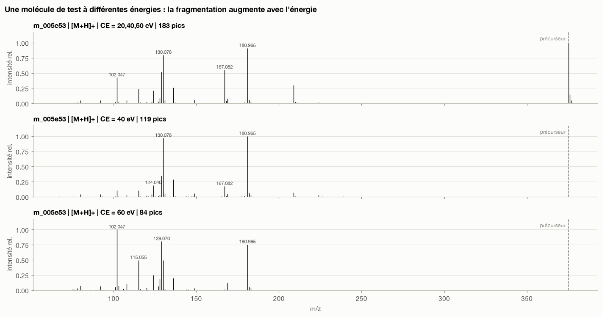
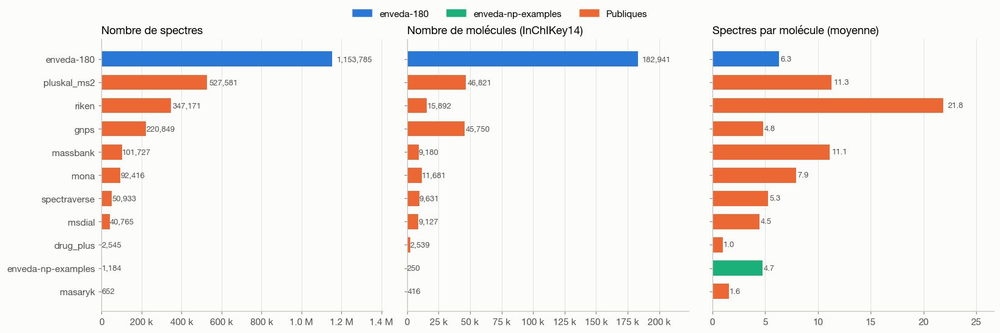
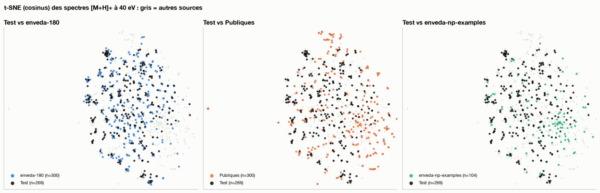
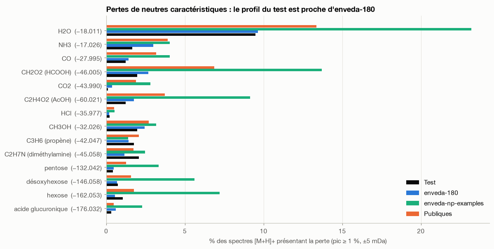

# Identifier une molécule à partir de ses spectres de masse — Kaggle CASMI 2026


Analyse exploratoire des données de la compétition Kaggle
[**Enveda CASMI 2026 — Molecule ID from Mass Spectra**](https://www.kaggle.com/competitions/enveda-CASMI26-molecule-id-mass-spectra),
réalisée dans le cadre du cursus IODAA (AgroParisTech).

> **Le problème.** On reçoit un ou plusieurs spectres de masse en tandem (MS/MS) d'une molécule inconnue
> et on doit proposer jusqu'à **25 structures candidates (SMILES)**, classées par probabilité.
> L'évaluation se fait en **MRR@25** sur l'InChIKey14 (connectivité 2D : stéréochimie et tautomérie ignorées).

<p align="center">
  
</p>

## Les données en bref

| | Train | Test |
|---|---|---|
| Spectres | 2 539 608 | 1 213 |
| Molécules (InChIKey14) | 275 810 | 400 |
| Sources | 11 bibliothèques hétérogènes | 1 plateforme (timsTOF) |
| Adduits | 121 | 7 |
| Pics par spectre (médiane) | 42 | 230 |

Chaque ligne est **un spectre** (liste de couples m/z–intensité + métadonnées : `precursor_mz`, adduit,
énergie de collision, instrument). La cible est la structure de la molécule.

## Principaux enseignements

1. **Un train hétérogène, un test homogène.** Le train assemble 11 bibliothèques (83 libellés d'instruments,
   4 unités d'énergie de collision). Seule `enveda-180` (45 % du train, timsTOF, CE 20/40/60 eV) ressemble vraiment au test.

   <p align="center"></p>

2. **Un domain shift mesurable.** Les spectres de test sont plus denses et plus bruités (230 pics en médiane contre 42)
   et contiennent souvent l'enveloppe isotopique du précurseur. En t-SNE comme en pertes de neutres,
   le test se superpose à `enveda-180` plutôt qu'aux bibliothèques publiques.

   <p align="center"></p>
   <p align="center"></p>

3. **La masse fait l'essentiel du filtrage.** `precursor_mz` + adduit donnent la masse neutre exacte
   (246–439 Da en test). Pour chaque molécule de test, on trouve en médiane 55 isobares du train à ±5 ppm :
   ce sont des voisins structuraux, pas des réponses, car les molécules de test sont nouvelles.
   Une base de candidats externe (PubChem, COCONUT) sera nécessaire.

4. **Des indices chimiques simples.** 53 % des molécules de test ont une masse nominale impaire
   (règle de l'azote : nombre impair d'atomes N), alors que les exemples de produits naturels fournis sont pauvres en azote.

5. **Validation.** Splitter par molécule, idéalement par scaffold de Murcko, sur un sous-ensemble « proche du test »
   (`enveda-180`, 7 adduits, CE 20/40/60 eV).

L'étude complète (dictionnaire des features, problèmes de qualité, pistes de feature engineering, stratégie de validation)
est dans [`ETUDE_DONNEES.md`](ETUDE_DONNEES.md).

## Contenu

| Fichier | Description |
|---|---|
| [`01_EDA.ipynb`](01_EDA.ipynb) | Notebook d'analyse exploratoire (12 sections, 24 figures) : qualité, sources, adduits, énergies, anatomie des spectres, pertes de neutres, espace chimique RDKit, domain shift |
| [`ETUDE_DONNEES.md`](ETUDE_DONNEES.md) | Synthèse écrite de l'étude et recommandations pour la modélisation |
| `figures/` | Figures clés extraites du notebook |
| `requirements.txt` | Dépendances Python |

## Reproduire l'analyse

```bash
pip install -r requirements.txt
# Télécharger les données (2,8 Go, compte Kaggle requis)
kaggle competitions download -c enveda-CASMI26-molecule-id-mass-spectra
unzip enveda-CASMI26-molecule-id-mass-spectra.zip -d "enveda-CASMI26-molecule-id-mass-spectra (1)"
jupyter notebook 01_EDA.ipynb
```

Le notebook lit `train.parquet` par *row groups* pour ne pas charger les 2,8 Go en mémoire,
et met en cache un échantillon stratifié de 3 % dans `cache/` (non versionné).

## Stack

Python · Polars · PyArrow · NumPy · Matplotlib · scikit-learn (t-SNE) · RDKit

---

*Aymen Mhirit — AgroParisTech, IODAA*
